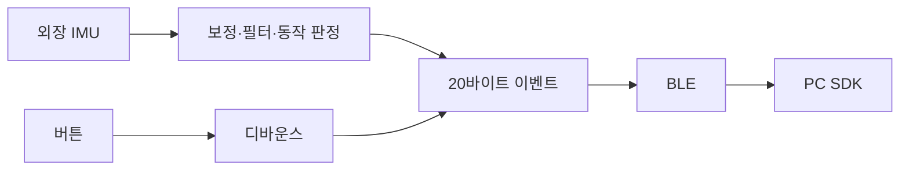

# Digital Tennis Controller Firmware

**라켓의 움직임을 게임 입력으로 바꾸는 BLE 펌웨어.** NU40-DK와 별도 외장 IMU에서 샘플을 읽고, 보정·스윙 판정을 거쳐 작은 이벤트를 PC로 보냅니다.

[장비 없이 시작하기](#장비-없이-시작하기) · [보드 빌드](#보드-빌드) · [하드웨어·구조 문서](docs/architecture.md) · [기여하기](CONTRIBUTING.md)

## 동작 방식



센서의 원시 샘플을 매번 PC로 스트리밍하는 대신 **펌웨어에서 물리 동작을 판정**합니다. PC는 패킷과 연결 상태를 검증하고, 게임은 해당 스윙이 실제 공을 칠 수 있는지 판정합니다. [역할 분담과 설계 근거](https://github.com/digital-tennis/digital-tennis-docs/blob/main/docs/project/architecture.md)

## 주요 기능

- 100Hz 취득 경계와 정지 보정, 장착 축 변환·필터·상대각·세기 계산
- 기본 포핸드·백핸드·서브 분류, 특수 샷 모드와 녹화 기반 판정 프로필 주입
- 버튼 디바운스, 누르는 동안 중복 입력 억제, 부팅 시 눌린 버튼 제외
- 유한 송신 큐, 재시도·만료, 재접속 시 이전 입력 폐기
- 암호화된 GATT, 영속 본딩, 센서 없이 확인하는 `LINK_PROBE / LINK_REPLY`
- 센서와 BLE 전파 없이 실행하는 C 호스트 검사

## 하드웨어 지원 범위

| 대상 | 용도 | 현재 상태 |
| --- | --- | --- |
| **NU40-DK + 별도 외장 IMU** | 실제 제품 타깃 | 보드·드라이버 분기 컴파일 가능. 실물 센서 모델·배선·장착 축 확정 및 인식률 검증 필요 |
| NU-54 | 센서 없는 임시 BLE 시험 | Mac Unity 일반 창에서 본딩·메시지 왕복·보드 재시작 후 재연결 확인 |

내장 IMU를 전제하지 않습니다. 외장 센서가 없거나 준비되지 않으면 모션 입력을 만들지 않습니다. NU-54 지원은 NU40-DK 요구를 대체하지 않습니다. [Mac 실제 본딩·왕복·재시작 검수](https://github.com/digital-tennis/digital-tennis-game/blob/7af42a20b42975b21a41ab3f7055c6846fb510e9/docs/controller-bonding.md)를 확인할 수 있습니다. 합성 입력에서 통과한 동작 분류를 사람의 실제 제스처 정확도로 해석하지 않습니다.

보드 구조·GPIO는 [chcbaram/nu40dk-kit](https://github.com/chcbaram/nu40dk-kit)을 참고했으며, 고정 출처와 원래 라이선스를 보존합니다. 보드 리비전과 센서 전압·버스·주소는 연결 전에 확인해야 합니다. [보드·GPIO·저장영역 상세](docs/architecture.md)

## 장비 없이 시작하기

**CMake 3.20 이상, C99 컴파일러, Git**이 필요합니다. protocol 의존성은 검토한 커밋으로 자동 취득합니다.

```sh
git clone https://github.com/digital-tennis/digital-tennis-firmware.git
cd digital-tennis-firmware
cmake -S . -B .work/host
cmake --build .work/host
ctest --test-dir .work/host --output-on-failure
```

성공하면 `external_imu_pipeline`, `transport_and_buttons` 검사가 통과합니다. 모의 센서의 준비·보정·스윙과 버튼·송신 실패·만료를 확인하며 실제 보드를 변경하지 않습니다.

로컬 protocol 소스를 사용하려면 첫 설정에 `-DDT_PROTOCOL_ROOT=/absolute/path/to/digital-tennis-protocol`을 추가합니다.

## 보드 빌드

확인한 환경은 **nRF Connect SDK 3.4.1 / Zephyr 4.4.2**와 해당 Nordic 도구체인입니다. 기존 NCS workspace와 도구체인이 설치되어 있어야 합니다.

```sh
python3 tools/build-board.py \
  --sdk-root /absolute/path/to/ncs/v3.4.1 \
  --toolchain /absolute/path/to/nordic/toolchain
```

기본 타깃은 `nu40dk_kit/nrf52840`입니다. 이 명령은 **컴파일만** 수행합니다. 확인한 외장 센서 배선은 별도 overlay로 만들고 `--overlay /absolute/path/to/external-imu.overlay`로 추가합니다. 기본 GPIO·저장 설정은 유지됩니다.

센서 없는 기본 빌드로는 센서 인식이 완료되지 않습니다. 시험 fixture의 핀·주소를 실제 배선으로 사용하지 마세요. 설치 절차와 NU-54의 별도 저장 맵은 [하드웨어 문서](docs/architecture.md)에 있습니다.

## PC와 연결하기

펌웨어는 BLE **Peripheral / GATT Server**, PC는 Central입니다. PC에서는 [Digital Tennis BLE SDK](https://github.com/digital-tennis/digital-tennis-ble-unity) 또는 [게임의 컨트롤러 설정](https://github.com/digital-tennis/digital-tennis-game)을 사용합니다.

1. 기기를 검색하고 선택한 기기에 연결합니다.
2. OS 페어링·암호화·현재 상대의 본딩 상태를 확인합니다.
3. 통신 확인 요청의 실제 응답을 확인합니다. 이 단계에는 IMU가 필요하지 않습니다.
4. 외장 IMU 준비 후 보정과 서브·스윙·스킬 테스트를 진행합니다.

현재 화면 없는 시험 기기는 **LE Secure Connections + Just Works**를 사용합니다. 통신은 암호화되지만 최초 페어링의 PIN·숫자 대조에 의한 중간자 방어는 제공하지 않습니다. 통신 규격의 단위·버전·필드는 [protocol](https://github.com/digital-tennis/digital-tennis-protocol)이 기준입니다.

## 소스 안내

| 경로 | 역할 |
| --- | --- |
| `src/hw/driver/` | 외장 IMU·GPIO의 Zephyr 연동 |
| `src/ap/` | 보정·동작·버튼·송신 큐·BLE 서비스 |
| `src/common/` | 플랫폼과 분리한 데이터·설정·포트 계약 |
| `boards/`, `overlays/` | 보드 정의와 앱별 하드웨어 설정 |
| `tests/`, `tools/` | 호스트 검사, 컴파일 fixture, 빌드·설치 도구 |

[구조와 확장 방법](docs/architecture.md) · [보드 빌드 기록](docs/board-build-validation.json) · [모션·송신 검사 기록](docs/controller-refinement-validation.json) · [GPIO·본딩 빌드 기록](docs/bonding-build-validation.json)

## 도움말·기여

[Digital Tennis](https://github.com/digital-tennis)가 관리합니다. [Issues](https://github.com/digital-tennis/digital-tennis-firmware/issues)에 보드 리비전, 외장 센서 모델, SDK 버전, 재현 절차를 남겨 주세요. 장치 주소·본딩 정보는 제외합니다. [기여 안내](CONTRIBUTING.md)와 [초보자용 펌웨어 과제](https://github.com/digital-tennis/digital-tennis-docs/blob/main/docs/products/digital-tennis-firmware.md)를 참고하세요.

## 라이선스

직접 작성한 코드·문서는 [Apache-2.0](LICENSE)입니다. [NOTICE](NOTICE)를 포함하며, 참고 보드 코드의 MIT 등 원래 조건은 [외부 코드 고지](THIRD_PARTY_NOTICES.md)를 따릅니다.

### NU-54 버튼 입력 시험 모드

NU-54 빌드는 SW1=서브, SW2=포핸드, SW3=백핸드, SW4=스킬을 v2 BUTTON4~7로 전송합니다. 외장 IMU는 사용하지 않으며 센서 준비·보정 flags는 거짓입니다. 본딩 후 LINK_REPLY.kind=1로 모드를 알리고, Unity의 세 입력 테스트 후 저장해야 경기에 적용됩니다. NU40-DK의 기존 외장 IMU 모드와 보정 절차는 유지합니다. 30ms 디바운스, 길게 누름 1회, 부팅 중 누른 버튼 제외와 eventId 기반 중복 제거가 적용됩니다. 스킬은 게임에서 실제 충전한 재고가 있어야 발동합니다.
